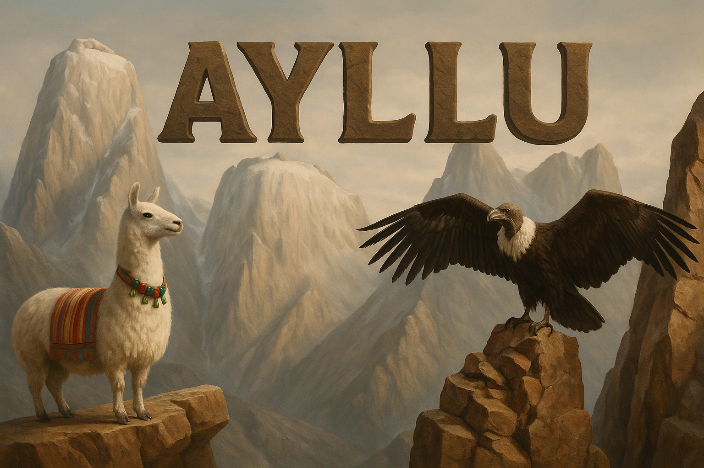
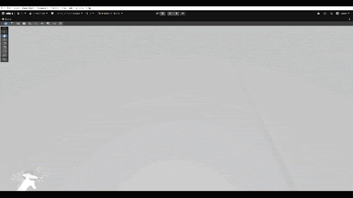
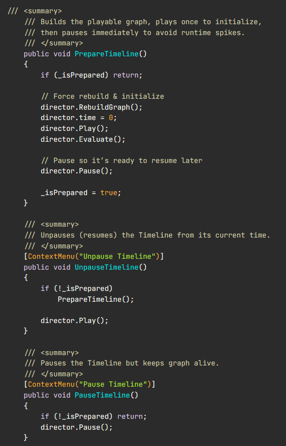
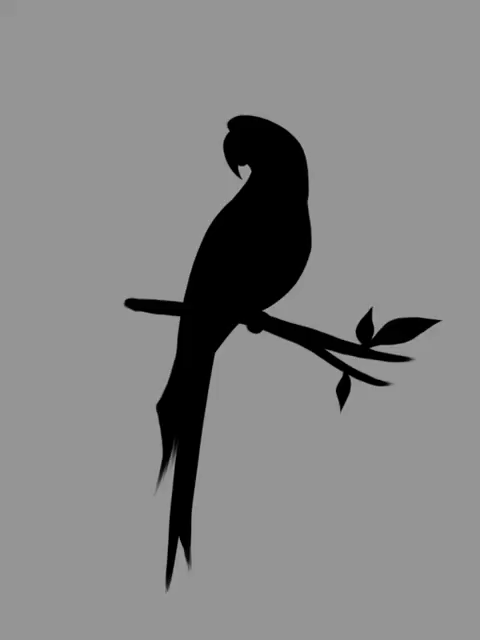

 

# Ayllu — Flying of the Condor

**A story-driven MR/VR experience rebuilt from scratch in two weeks, featuring redirected walking, portal transitions, and interactive story events.**

I rebuilt the project after the previous team failed to deliver a working experience, implementing the core gameplay systems and coordinating animation, visual effects, and cinematic events.

---

## Overview

Ayllu is a story-driven Mixed Reality / Virtual Reality experience built in Unity. It combines immersive movement, portal transitions, animated characters, and cinematic story moments into a coordinated experience.

I rebuilt the project from scratch in two weeks, focusing on restoring a working experience and implementing the systems needed to support its gameplay and story sequences.

### Key Features

- **Redirected Walking** for immersive movement through the experience.
- **Portal Transitions** to connect story environments.
- **Spline-Driven Events** to trigger actions at specific moments.
- **Timeline Prewarming** to help reduce first-playback stutters.
- **Asynchronous Animation** for sprite and shader-driven effects.
- **Character Visual Effects** for magical appearance and hand effects.
- **Event Coordination** to synchronize gameplay, animation, and story moments.

### Technologies

`Unity` · `C#` · `VR/MR` · `UniTask` · `Unity Timeline` · `Unity Splines` · `Shader Graph` · `Visual Effect Graph`

## Code & System Architecture

The project uses separate components for timing, animation, spline events, timeline preparation, and visual effects. Each system handles a focused responsibility and helps coordinate interactive story moments.

### 1. Timer System

A UniTask-based timer that invokes a Unity event after a specified delay. It supports configurable durations, completion callbacks, and cancellation, and cleans up asynchronous work when the component is disabled.

**Code concepts:** UniTask countdowns, UnityEvents, `CancellationTokenSource`, start/stop controls, and lifecycle cleanup.

  

### 2. Sprite Animation System

An asynchronous flipbook animation system that displays `Texture2D` frames on a `MeshRenderer`. It supports configurable playback speed, optional looping, and a completion event.

This system was used to display the Cross animation.

**Code concepts:** frame playback, animation speed, looping, completion callbacks, and cancellation on disable.

  

### 3. Llama Appearance System

Controls dissolve-style appearance effects by animating the shader's `_Disappear` property over time using UniTask. It allows the llama to appear and disappear smoothly during key story moments.

**Code concepts:** shader property interpolation, asynchronous animation, per-frame updates, and Unity Editor context-menu testing.

  

### 4. Spline Events Invoker

A lightweight event system that connects spline progress to UnityEvents. It triggers configured actions at precise points in an animation or sequence, such as audio, transitions, and character actions.

**Code concepts:** spline timing, configured event points, UnityEvents, and coordination between animation and gameplay.

  

### 5. Timeline Prewarm Controller

Prepares Unity Timeline sequences before they are needed, helping reduce stutters and frame spikes during important cinematic moments. It builds and evaluates the playable graph before pausing the timeline until playback is required.

**Code concepts:** playable graph initialization, timeline evaluation, pause/resume controls, and restart behavior.

  

### 6. Hand VFX Graph

Creates particle effects across an animated skinned mesh and updates particle positions as the character moves. It samples mesh vertices, applies randomized offsets and sizes, and uses Unity Visual Effect Graph to create magical hand effects.

**Code concepts:** `SkinnedMeshRenderer` vertex sampling, particle placement, randomized variation, and position updates.

  

## Extra Media

Additional story sequences, character animations, and visual effects from the project.

### Story Sequences

  

- [Ayllu Fire Story — Video](Docs/Ayllu%20Fire%20Story.mp4)
- [Condor Arrival — Video](Docs/Condor%20Arival.mov)
- [Condor Landing — Video](Docs/Condor%20Landing.mp4)

### Character Animations

  
  

- [Fox Dancing — GIF](Docs/Fox%20Dancing.gif)
- [Pigeon Animation — GIF](Docs/Pigeon.gif)
- [Cross Animation — GIF](Docs/Cross.gif)
- [Llama Appearance — GIF](Docs/Llama%20Apear.gif)

### Visual Effects

  

- [Hand VFX — GIF](Docs/Hand%20VFX.gif)

---

**Ayllu — Flying of the Condor**

Unity · C# · VR/MR

